<p align="center">
  
</p>

<p align="center">
  
  <a href="https://www.xpinc.com/"></a>
  
  
</p>

### `$ cat Engineer.java`

```java
record Engineer(String name, String role, String company, String location, int since, List<String> focus) {}

var me = new Engineer(
    "Elmeri Moreno",
    "Senior Software Engineer",
    "XP Inc",
    "São Paulo, Brazil",
    2015,
    List.of("Backend systems", "APIs", "Event-driven architectures")
);
```

### `$ tree ~/stack`

<table>
  <tr>
    <td><code>├── languages/</code></td>
    <td>
      <a href="https://dev.java/" title="Java"></a>
      <a href="https://spring.io/projects/spring-boot" title="Spring Boot"></a>
      <a href="https://learn.microsoft.com/dotnet/csharp/" title="C#"></a>
      <a href="https://dotnet.microsoft.com/" title=".NET"></a>
      <a href="https://www.typescriptlang.org/" title="TypeScript"></a>
      <a href="https://nodejs.org/" title="Node.js"></a>
      <a href="https://nestjs.com/" title="NestJS"></a>
    </td>
  </tr>
  <tr>
    <td><code>├── messaging/</code></td>
    <td>
      <a href="https://kafka.apache.org/" title="Apache Kafka"></a>
      <a href="https://www.rabbitmq.com/" title="RabbitMQ"></a>
      <a href="https://aws.amazon.com/sqs/" title="Amazon SQS"></a>
    </td>
  </tr>
  <tr>
    <td><code>├── databases/</code></td>
    <td>
      <a href="https://www.postgresql.org/" title="PostgreSQL"></a>
      <a href="https://www.mysql.com/" title="MySQL"></a>
      <a href="https://www.mongodb.com/" title="MongoDB"></a>
      <a href="https://redis.io/" title="Redis"></a>
      <a href="https://www.microsoft.com/sql-server" title="SQL Server"></a>
    </td>
  </tr>
  <tr>
    <td><code>├── cloud/</code></td>
    <td>
      <a href="https://azure.microsoft.com/" title="Microsoft Azure"></a>
      <a href="https://aws.amazon.com/" title="AWS"></a>
    </td>
  </tr>
  <tr>
    <td><code>├── containers/</code></td>
    <td>
      <a href="https://www.docker.com/" title="Docker"></a>
      <a href="https://kubernetes.io/" title="Kubernetes"></a>
    </td>
  </tr>
  <tr>
    <td><code>└── ci-cd/</code></td>
    <td>
      <a href="https://azure.microsoft.com/products/devops/pipelines" title="Azure Pipelines"></a>
    </td>
  </tr>
</table>

### `$ git shortlog --summary`

<p align="center">
  
  
</p>

### `$ git log --graph`

<picture>
  <source media="(prefers-color-scheme: dark)" srcset="https://raw.githubusercontent.com/ejmeri/ejmeri/output/github-contribution-grid-snake-dark.svg" />
  <source media="(prefers-color-scheme: light)" srcset="https://raw.githubusercontent.com/ejmeri/ejmeri/output/github-contribution-grid-snake.svg" />
  
</picture>

<p align="center"><sub><code>$ exit 0</code></sub></p>
