<h1 align="center">Hi there, I'm Elmeri Moreno 👋</h1>

  

## 👨🏻‍💻 About me

- 💼 **Senior Software Engineer** at [**XP Inc**](https://www.xpinc.com/)
- 🧭 **10+ years** building software professionally, since 2015
- ⚙️ Focused on **backend systems**, **APIs** and **event-driven architectures**
- 📍 Based in **São Paulo, Brazil** 🇧🇷

## ⚡ Tech Stack

**Languages & Frameworks**

**Messaging & Streaming**

**Databases & Caching**

## 📊 GitHub Stats

  
  

